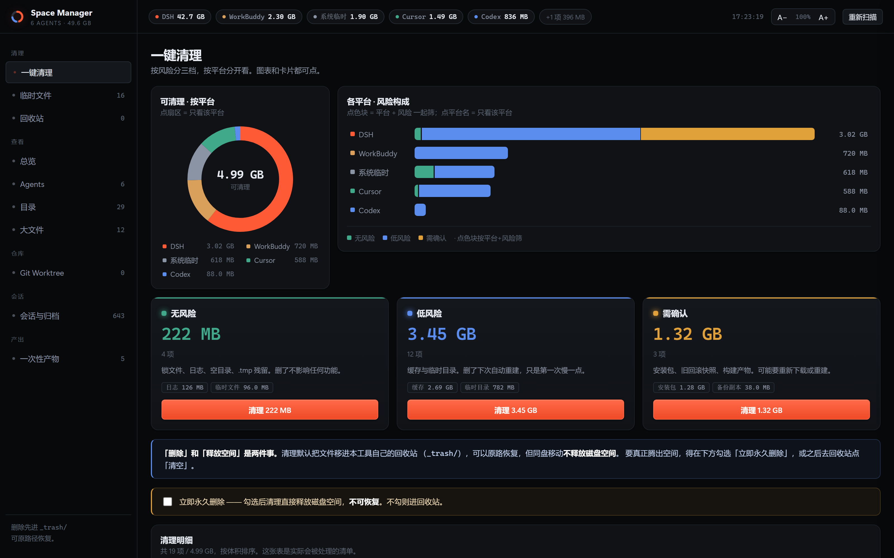
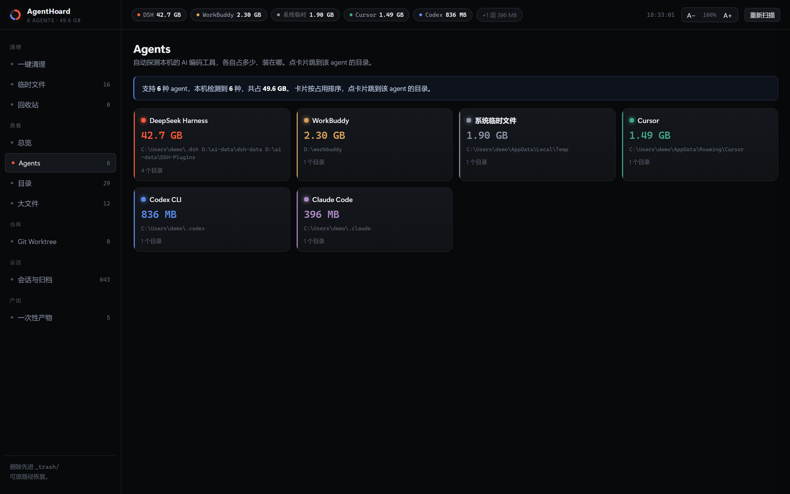
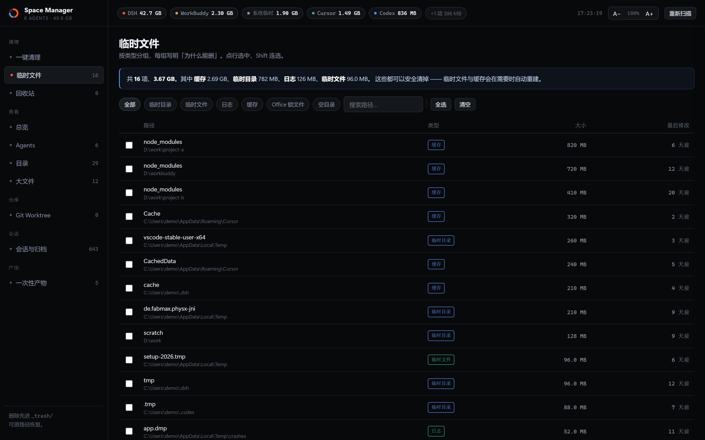

# AgentHoard

> AI agents hoard. See what, and take it back.

本地磁盘空间管理台，专治 **AI 编码 agent 在硬盘上留下的垃圾**。
零依赖（Node 内置模块），只绑 `127.0.0.1`，数据不出本机。



> 截图使用虚构的演示数据（`npm run demo` 生成），不含任何真实路径。

> **平台**：Windows 10/11 优先，已实测。macOS / Linux **未测试** —— 盘符统计（`fs.statfsSync('C:\\')`）、
> junction 去重、`%TEMP%` 路径都是 Windows 语义，其他平台能启动但行为不保证。
> **运行环境**：Node.js ≥ 18.15（用到 `fs.statfsSync`）。

## 快速开始

```bash
git clone <repo> && cd agent-hoard
node server.mjs
```

打开 http://127.0.0.1:5178 ，点「开始扫描」。
Windows 上也可以双击 `start.cmd`，它会检查 Node、启动服务并打开浏览器。

**第一次打开是一张引导卡，不是白屏**：点开始后显示实时进度（当前扫到哪个 agent、已扫多少文件 / 多少 GB），
扫描期间服务仍能响应请求，可以切到别的窗口。

> 为什么不打包成 exe：目标用户都装了 Node（Claude Code / Codex 本身就是 npm 装的），
> 而 90 MB 的未签名 exe 做「删文件」操作极易被 SmartScreen 拦。源码 225 KB，`start.cmd` 双击即用。

扫描耗时取决于文件数，**不是固定值**：

| 文件数 | 大致耗时 |
|---:|---|
| ~10 万 | 15–25 秒 |
| ~30 万 | 60–90 秒 |
| ~200 万 | 90–180 秒 |

第二次扫描会更快（进度也更准，用上次的目录大小做了权重）。

**三个入口共用一套核心逻辑**（`lib/core.mjs`）：

| 入口 | 命令 | 适合 |
|---|---|---|
| Web UI | `node server.mjs` → http://127.0.0.1:5178 | 看图、点选、批量挑 |
| MCP Server | `node mcp-server.mjs` | 让 agent 自己调清理能力 |
| CLI | `node cli.mjs <cmd>` | 脚本 / 远程 / 无浏览器 |

---

## 和别人比，它多了什么

同类工具（[agent-cleaner](https://github.com/funny-dog/agent-cleaner)、[agent-residue](https://github.com/0721gaoshoua/agent-residue)、[spoilheap](https://github.com/Blackman99/spoilheap)、[agent-footprint](https://github.com/jvroth18/agent-footprint)）覆盖的，这里都有；除此之外补了四块：

1. **可视化联动** —— 风险 × 平台二维图表，点扇区就筛到「Codex 的低风险项」，CLI 类工具做不到
2. **两个只在真机上才踩得到的去重坑**
   - **junction 去重**：`~/.dsh/sessions` 是指向 `D:\dsh-data` 的目录联接，跟着走会把同一份数据算两遍（本机凭空多算 2 GB）
   - **父子去重**：目录是树，全选会父子重复累加。修之前全选报 269 GB —— 超过磁盘总量
3. **归档 ≠ 省空间** —— 直接告出 `archivedSessionIds` 在哪，并算给你看：归档了多少个、占多少 MB，一点没少
4. **git worktree 走 `git worktree remove`** —— 不是 `rm -rf`；判定 dirty / unmerged 的默认拒绝

---

## 支持的 agent（22 种，自动探测）

DSH、Codex CLI、Claude Code、Cursor、Gemini CLI、Aider、OpenCode、Windsurf、Continue、Cline、Roo Code、GitHub Copilot CLI、Ollama、LM Studio、WorkBuddy、Qoder、Trae、Zed、Amp、Kilo Code、OpenHands，外加「系统临时文件」。

不靠写死的清单跑，而是逐个候选路径 `stat`，存在才纳入扫描。常见情况是 22 种里能命中 5–8 种。

```
node cli.mjs agents
```

---

## 设计系统与动效

### Token（全部动画只引用这里，不写裸值）

```css
--ease-out:    cubic-bezier(.22,1,.36,1)     /* 默认出场 */
--ease-spring: cubic-bezier(.34,1.42,.5,1)   /* 抽屉、选择条 */
--t-micro:120ms  --t-fast:200ms  --t-base:300ms  --t-slow:520ms
--r-sm:6px  --r:9px  --r-lg:13px             /* 圆角阶梯 */
--sh-1 / --sh-2 / --sh-3                     /* 阴影只在需要抬升时用 */
```

底色分五层（`--bg → --panel4`），靠明度递进区分层次，不靠边框堆叠。

### 动效清单

| 位置 | 动效 | 说明 |
|---|---|---|
| 切页 | 子元素淡入 + 上移 10px，错峰 45ms | 只作用直接子元素，不会连坐 |
| KPI / 三档 / Agent 卡片 | 数字从旧值滚到新值（620ms ease-out-cubic） | 复用上次的值，切筛选也连续 |
| 环形图 | 弧线按 `stroke-dashoffset` 逐段画出，每段 +70ms | `pathLength="1"` 归一化，不依赖周长 |
| 同级条形图 | `scaleX` 从左展开，错峰 40ms | 用 transform 不用 width，避免布局抖动 |
| 平台堆叠条 | 每段从左展开 | 同上 |
| 表格行 | 只前 22 行淡入，错峰 18ms | 800 行全动会卡，所以封顶 |
| 选择条 | 从底部弹入（spring） | 不再突然冒出来 |
| Toast | 弹入 + 淡出 | spring 落位 |
| 抽屉 | spring 缓动滑入 | |
| 按钮 / 卡片 hover | 轻微上浮 + 阴影升级，按下缩放 0.975 | |
| 扫描中 | 旋转指示器 + 骨架微光 | |

### 减少动效

`prefers-reduced-motion: reduce` 下：所有动画与过渡关闭，**并显式把入场元素归位**
（`.stagger`、`.view > *` 强制 `opacity:1; transform:none`），
环形图 `stroke-dashoffset:0`，条形 `scaleX(1)` —— 保证内容在终态可见，不会因为动画被跳过而空白。
加载指示器是唯一保留的动画（放慢到 1.8s），因为它传达状态而非装饰。

---

## 风险分级


每个清理候选都带风险等级，一键清理按级执行。

| 档 | 包含什么 | 删了会怎样 |
|---|---|---|
| **无风险** | `~$*` Office 锁文件、`.tmp`/`.crdownload`、日志与崩溃转储、空目录 | 不影响任何功能 |
| **低风险** | `node_modules`、`__pycache__`、`.uv-cache`、pip/npm 缓存、`tmp`/`temp`/`scratch` | 下次自动重建，代价随体积走：500 MB 的 `node_modules` 重装通常 2–5 分钟（看网速），pip 缓存重建 1–3 分钟 |
| **需确认** | 安装包 `.7z/.zip/.whl/.msi/.iso`、一周以上的旧快照、`.bak`/`_backup-*` | 可能要重新下载或重建 |
| **不动手** | 模型权重、会话记录、附件、日记、微信文件、各 agent 的凭据 | 不提供一键入口 |

### 硬保护名单

无论落在哪一档，这些**永远不进清理计划**：

```
\attachments\  \sessions\  \models\  \archived_sessions\
whale-diary  \memory\  xwechat_files  \微信\
.dsh\profiles\  dsh-shadow\  dsh-runtime\      ← DSH 自身构建产物，删了界面直接崩
.credentials  .codex\auth  .claude\.credentials  ← 凭据
.venv\  venv\  site-packages\                  ← 删掉等于重装 Python
._npx\                                          ← 里面有正在运行的 DSH
.git\                                           ← worktree 走专门逻辑
```

---

## Web UI



顶栏那排药丸是**动态的**：按占用从大到小列出所有检测到且非空的 agent，
超出显示能力时收成 `+N 项 xxx`（点它跳 Agents 页）；宽度越小显示的越少，不会挤爆。
每个药丸可点，等于「只看这个 agent」，再点一次取消。

| 页 | 用途 |
|---|---|
| **一键清理** | 平台甜甜圈 + 风险堆叠条 + 三档卡片 + 明细表（平台列） |
| **临时文件** | 只列 tmp/log/cache/锁文件/空目录，按类型分组，写明为什么能删 |
| **Agents** | 22 种 agent 的探测结果与占用，点卡片跳到该 agent 的目录 |
| **Git Worktree** | worktree 清单与四类判定，可安全移除的给按钮 |
| **目录 / 大文件 / 会话 / 一次性产物** | 浏览与手动挑选，全支持批量多选 |
| **回收站** | 每批可恢复或清空 |

### 临时文件



按类型分组（临时目录 / 临时文件 / 日志 / 缓存 / Office 锁文件 / 空目录），
每组写明「为什么能删」，顶部算好各类占多少。

### 一键清理的图表（都可点）

- **左：可清理 · 按平台（甜甜圈）** —— 点扇区或图例 = 只看该平台
- **右：各平台 · 风险构成（堆叠条）** —— 点色块 = 平台 + 风险一起筛；点平台名 = 只看该平台

筛选双向联动：选了 DSH，三档卡片变成「DSH · 74 项（全平台 193 项 5.59 GB）」，
清理按钮只清 DSH 那部分（`/api/clean` 带 `platform`）。

### 多选

- **点任意一行** = 选中，再点取消（不用瞄准小方框）
- **Shift + 点** = 整段连选；**Ctrl/Cmd + A** = 全选
- **表头复选框** = 全选当前筛选结果（含未显示的 4000+ 行）
- **快选**：`选 >1GB` / `选 >100MB` / `选全部可清理` / `选 30 天未用`
- 底部操作条实时显示「已选 N 项 · 共 X GB」

选中项会先做**父子压缩**再求和，所以全选显示的是真实总量，并注明「N 项已含在父目录里」——
修之前全选会累加出超过磁盘总量的数字。

---

## MCP Server

`mcp-server.mjs` 是标准 stdio 传输的 MCP 服务，9 个工具：

| 工具 | 作用 |
|---|---|
| `space_scan` | 扫描所有 agent 的数据目录 |
| `space_plan` | 三级清理计划（含平台拆分） |
| `space_agents` | 本机检测到的 agent 与占用 |
| `space_clean` | 清理一档，需 `confirm:true`，可限平台、可 `purge` |
| `space_sessions` | 会话与归档统计 |
| `space_worktrees` | worktree 清单与判定 |
| `space_worktree_remove` | 安全移除 worktree（走 git） |
| `space_trash` | 回收站批次 |
| `space_trash_purge` | 永久删除批次，需 `confirm:true` |

接入示例：

```json
{
  "mcpServers": {
    "agent-hoard": {
      "command": "node",
      "args": ["/<克隆到本机的位置>/agent-hoard/mcp-server.mjs"]
    }
  }
}
```

协议实现：JSON-RPC 2.0、按行分隔；支持 `initialize` / `tools/list` / `tools/call` / `ping`；
未知方法返回 `-32601`，未知工具返回 `-32602`，工具内异常以 `isError:true` 的 content 返回而不是崩连接。

---

## CLI

```bash
node cli.mjs scan                      # 扫描（带进度，按 agent 分组输出）
node cli.mjs scan --by-agent           # 额外给出「每个 agent 各有多少可清理」
node cli.mjs plan                      # 三级计划
node cli.mjs agents                    # agent 探测结果
node cli.mjs sessions                  # 会话与归档统计
node cli.mjs worktrees                 # worktree 清单
node cli.mjs worktree-remove <仓库> <名>  # 安全移除
node cli.mjs clean safe                # 清理（进回收站）
node cli.mjs clean low --purge         # 永久删除
node cli.mjs clean low --platform=dsh  # 只清某个 agent
node cli.mjs trash                     # 看回收站
node cli.mjs trash-purge all           # 清空
```

---

## Git worktree 判定

扫描 `repoRoots`（默认 `D:\Deepseek`、`~/code`、`~/src`、`~/projects`）找仓库，
读 `.git/worktrees/*/gitdir` 定位每个 worktree，然后：

| 判定 | 依据 | 处理 |
|---|---|---|
| `clean` | `git status --porcelain` 为空 **且** `rev-list HEAD --not --all` 为 0 | 可移除 |
| `dirty` | 有未提交改动 | 默认拒绝，需 `force` |
| `unmerged` | 有不在任何 ref 上的提交 | 默认拒绝，需 `force` |
| `broken` | 目录已不存在，只剩注册记录 | 走 `git worktree prune` |

移除用 `git worktree remove`，**分支和提交都保留在仓库里**。实测移除一个 380 MB 的
worktree：目录消失、注册清理、`git cat-file -t <sha>` 仍返回 `commit`。

---

## 关于「归档的对话占不占空间」

**占，一点没少省。**

- DSH：归档只往 `D:\dsh-data\storages\workspace.json` 的 `global.archivedSessionIds` 里记一个 ID，`session.v4.jsonl.zstd` 一个字节没动
- Codex：把 `~/.codex/sessions/**/rollout-*.jsonl` 移到 `~/.codex/archived_sessions/`，位置变了体积不变
- Claude Code：`~/.claude/projects/<slug>/*.jsonl`，没有独立归档概念

「会话与归档」页直接算给你看。想省空间只有删。

---

## 删除的两段式

1. 删除 = `rename` 到 `_trash/<时间戳>/`，写 `manifest.json` 记原路径
2. 恢复 = 按 manifest 原路放回（原路径被占用会报错，不覆盖）

**同盘 rename 只改目录项，不释放扇区。** 所以要么勾「立即永久删除」，要么之后去回收站点「清空」。
被进程占用的文件 `EPERM` 跳过并计数上报，不硬删。

---

## 安装 / 配置

```bash
git clone <repo> && cd agent-hoard
node server.mjs          # 无需 npm install，零依赖
# 打开 http://127.0.0.1:5178
```

第一次打开是空的，点右上角「重新扫描」（约 1–2 分钟，取决于文件数）。
如果什么都没扫到，说明数据不在默认位置 —— 设 `SPACE_ROOT` 或在 `config.json` 里加 `roots`。

环境变量：

| 变量 | 默认 | 说明 |
|---|---|---|
| `SPACE_ROOT` | `D:\` | 数据目录所在盘 |
| `PORT` | `5178` | HTTP 端口 |
| `HOST` | `127.0.0.1` | 绑定地址 |

`config.json`（参考 `config.example.json`）：

```json
{
  "autoDiscover": true,
  "roots": [{ "id": "my-cache", "label": "自建缓存", "path": "E:\\cache", "platform": "dsh" }],
  "repoRoots": ["D:\\code"]
}
```

`autoDiscover: true` 时自动探测 22 种 agent，`roots` 只作补充。

---

## API

| 端点 | 说明 |
|---|---|
| `GET /api/scan[?fresh=1]` | 扫描（约 90 s / 215 万文件），缓存在 `data/scan.json` |
| `GET /api/plan` | 三级计划 + `platforms` 汇总，已做父子压缩 + 存在性校验 |
| `POST /api/clean` | `{tier, confirm, purge, platform?}` |
| `GET /api/agents` | agent 探测结果 |
| `GET /api/sessions` | 会话清单与归档统计 |
| `POST /api/sessions/archive` | `{platform, ids, want}` |
| `GET /api/worktrees` | worktree 清单 + 汇总 |
| `POST /api/worktrees/remove` | `{repo, name, force?}` |
| `POST /api/trash` | `{paths}` |
| `GET /api/trash/list` | 批次列表 |
| `POST /api/trash/restore` / `purge` | 恢复 / 永久删除 |

---

## 验收

```bash
npm test
```

它自己起服务（临时端口 + 演示数据 + 独立回收站）、跑完再清理，不碰你的真实配置：

| 层 | 内容 |
|---|---|
| API 与安全护栏 | 19 项：端点可用、`confirm` 强制、盘根拒绝、目录穿越拒绝、路径穿越拒绝 |
| MCP 协议 | initialize / tools/list(9) / 未知方法 -32601 / 缺 confirm 拒绝 |
| CLI | 帮助输出完整 |
| 界面 | 动效与减少动效、布局溢出、平台图表交互、顶栏、Agents 页（需 Edge，没有则跳过） |

单独跑某一套：

```powershell
# 起一个带 CDP 的 Edge
msedge --headless=new --remote-debugging-port=9599 --user-data-dir=%TEMP%\e http://127.0.0.1:5178
node scripts\verify-platform.mjs 9599
```

演示数据与截图：

```bash
npm run demo     # 生成 demo/data/scan.json（虚构路径）
npm run shots    # 用演示实例截图到 docs/screenshots/
```

---

## 已知边界

- 全量同步 `stat`，约 90 秒 / 215 万文件。结果缓存，页面秒开。
- 清理后「目录 / 大文件」视图是旧数据，需重新扫描；「一键清理」计划实时校验，立刻准确。
- 表格每页最多渲染 800 / 600 / 500 行，但**全选作用于全部筛选结果**。
- worktree 检测深度 4 层；`repoRoots` 里没有的仓库不会被发现。
- 只处理 agent 的数据目录与用户缓存，不碰工作区源码内容。

## License

MIT
